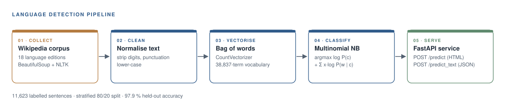
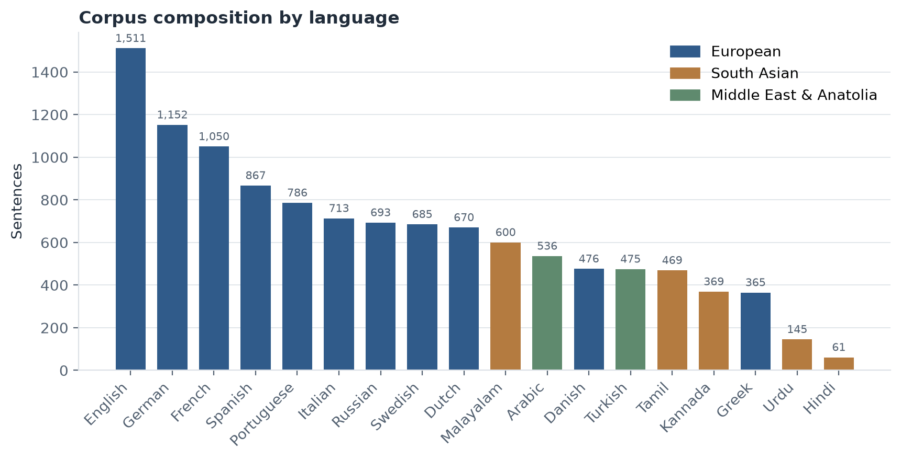
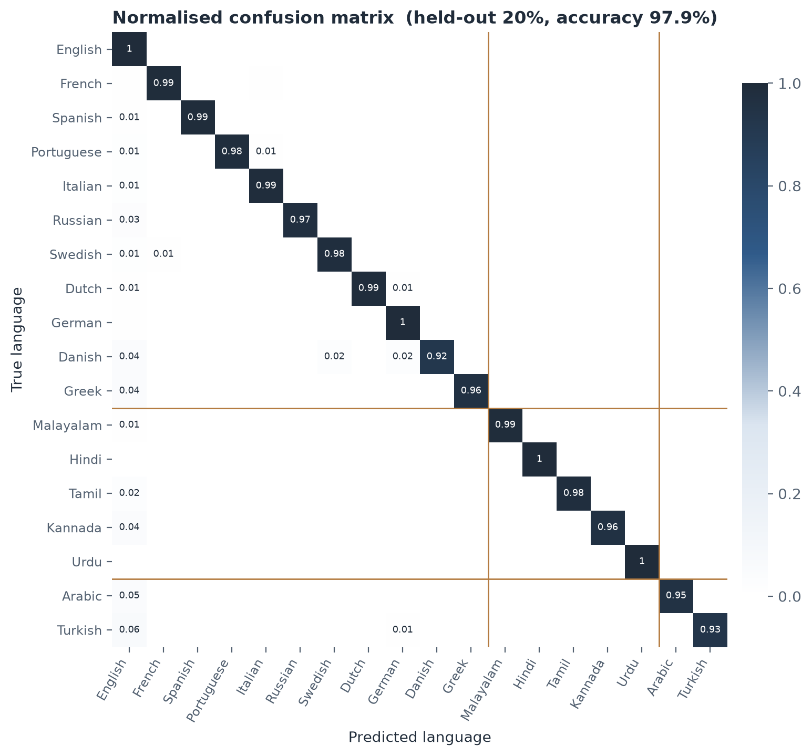
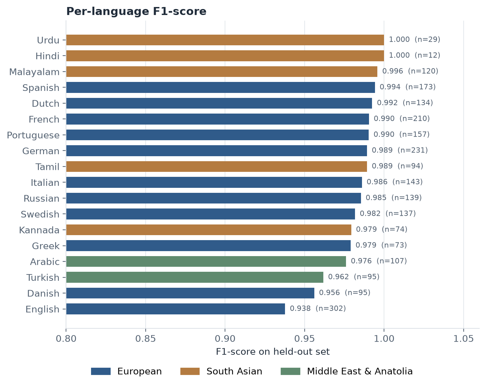
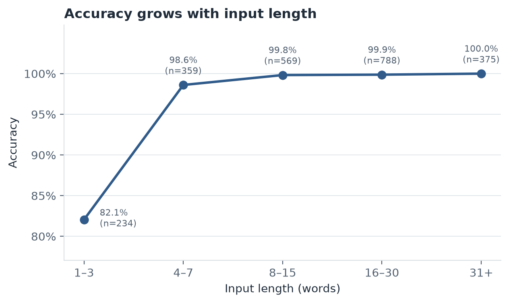

<div align="center">

# Language Detection with Multinomial Naïve Bayes

**A lightweight, interpretable classifier that identifies 18 languages across eight writing systems, trained on a Wikipedia corpus collected for this project and served through FastAPI.**


</div>

<p align="center"></p>

## At a glance

| | |
|---|---|
| **Task** | Multiclass language identification of free text |
| **Languages** | 18: 11 European, 5 South Asian, Arabic and Turkish |
| **Scripts covered** | Latin, Cyrillic, Greek, Arabic, Devanagari, Malayalam, Tamil, Kannada |
| **Corpus** | 11,623 labelled sentences from Wikipedia plus a parallel passage translated into each language |
| **Model** | Bag-of-words `CountVectorizer` → `MultinomialNB` (α = 1) |
| **Held-out accuracy** | **97.9 %** (stratified 80/20) · macro-F1 **0.983** |
| **5-fold CV accuracy** | **97.9 % ± 0.35 %** |
| **Serving** | FastAPI with an HTML form (`/predict`) and a JSON endpoint (`/predict_text`) |

## Why this approach

Language identification is usually the first stage of a multilingual NLP pipeline: it decides which tokenizer, spell-checker, translation model or search index handles a piece of text. For that job the classifier has to be **fast, small and predictable**. Multinomial Naïve Bayes over word counts meets all three requirements:

- **Training takes seconds** on a laptop, and inference is a sparse dot product.
- **It is interpretable.** Every decision comes down to per-word log-likelihoods, so you can see which tokens pushed a sentence towards a language.
- **Distinctive vocabulary dominates.** Function words such as *the*, *de*, *und*, *и* and *کے* are highly language-specific, so even a linear model separates the classes well.

For a vector of token counts **x**, the model picks the language

$$\hat{c} \;=\; \arg\max_{c}\; \Big[\log P(c) + \sum_{j} x_j \log P(w_j \mid c)\Big],$$

with Laplace-smoothed likelihoods $P(w_j \mid c)$ estimated from the training corpus.

## Dataset

[`Generate_DataSet.ipynb`](Generate_DataSet.ipynb) scrapes the `<p>` paragraphs of the same articles (*Nature*, *Wikipedia*, *Machine learning*, …) from each language edition of Wikipedia with `requests` + `BeautifulSoup`, then splits them into sentences with NLTK. Using parallel topics keeps the subject matter constant across languages, so the model learns **language** rather than **topic**. A parallel conversational passage, translated into each language, adds informal register alongside the encyclopaedic text.

<p align="center"></p>

The corpus is deliberately imbalanced in the way real traffic often is: English, German and French are abundant, while Urdu (145) and Hindi (61) are scarce. The evaluation below therefore reports macro-averaged as well as overall scores.

## Results

All numbers come from [`scripts/generate_figures.py`](scripts/generate_figures.py), which reproduces the notebook pipeline with a fixed seed and a stratified split. The raw metrics are written to [`assets/metrics.json`](assets/metrics.json).

<p align="center"></p>

- **Errors are rare and structured.** Almost all off-diagonal mass falls in the *English* column. Short fragments such as citation markers, numbers and proper nouns carry no language-specific words, so they default to the class with the largest prior.
- **No confusion between scripts.** Hindi and Urdu are mutually intelligible when spoken but use different scripts, and the model separates them perfectly. Most of the remaining confusion is between closely related Germanic languages (Danish, Swedish, German, Dutch).

<table>
<tr>
<td width="55%"></td>
<td width="45%"></td>
</tr>
</table>

- **Every language scores F1 ≥ 0.93**, and 12 of 18 score ≥ 0.98, including the smallest classes, Hindi and Urdu.
- **Accuracy depends mostly on input length.** Inputs of 1–3 words reach 82 %, while anything of 4 words or more reaches **≥ 98.6 %**, and sentences longer than 30 words are classified perfectly. For very short strings such as search queries and chat messages, a character n-gram model (see *Roadmap*) is the natural next step.

## Quick start

```bash
git clone https://github.com/danishzulfiqar/Language-Detection-NLP-Model.git
cd Language-Detection-NLP-Model
python -m venv .venv && source .venv/bin/activate
pip install -r requirements.txt

# 1. Train: run all cells of model.ipynb (writes model.pkl and transform.pkl)
jupyter nbconvert --to notebook --execute model.ipynb --inplace

# 2. Serve
python app.py            # http://localhost:8000
```

### API

```bash
curl -X POST http://localhost:8000/predict_text -F "text=Ceci est une phrase écrite en français"
# {"prediction":"French"}

curl -X POST http://localhost:8000/predict_text -F "text=یہ اردو زبان میں لکھا گیا جملہ ہے"
# {"prediction":"Urdu"}
```

| Method | Route | Body | Returns |
|---|---|---|---|
| `GET` | `/` | – | HTML form |
| `POST` | `/predict` | form field `text` | HTML page with the predicted language |
| `POST` | `/predict_text` | form field `text` | `{"prediction": "<Language>"}` |

### Reproduce the figures

```bash
python scripts/generate_figures.py   # writes assets/*.png and assets/metrics.json
```

## Repository layout

```
├── Generate_DataSet.ipynb     # Wikipedia scraping and sentence splitting → language_detection.csv
├── model.ipynb                # preprocessing, bag of words, training, evaluation, export
├── language_detection.csv     # 11,623 labelled sentences (Text, Language)
├── app.py                     # FastAPI app: HTML form + JSON endpoint
├── templates/ · static/       # front-end
├── scripts/generate_figures.py
└── assets/                    # figures and metrics used in this README
```

## Roadmap

- Character n-gram features (`analyzer="char_wb"`, n = 1–4) to improve very short inputs and unseen words.
- Load the model once at start-up instead of on every request, and return calibrated class probabilities.
- Extend coverage to Persian, Punjabi (Shahmukhi) and Pashto, which share the Arabic script with Urdu.

## Author

**Danish Zulfiqar**. [danishzulfiqar.com](https://danishzulfiqar.com) · [GitHub](https://github.com/danishzulfiqar)
